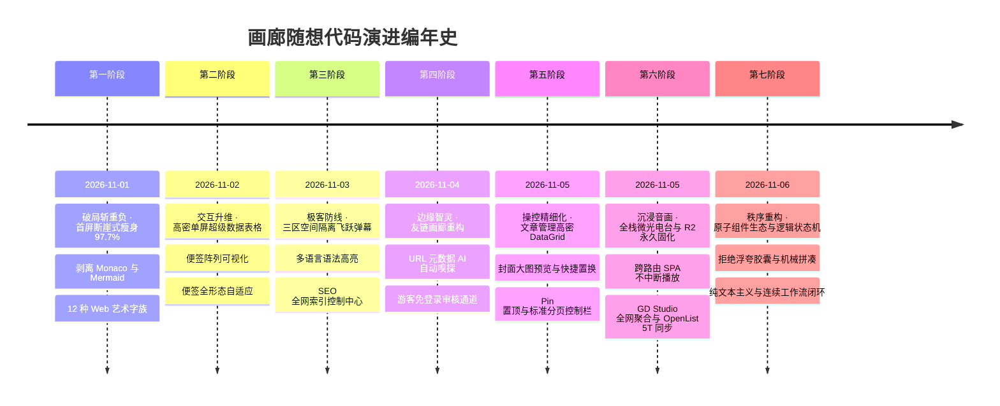
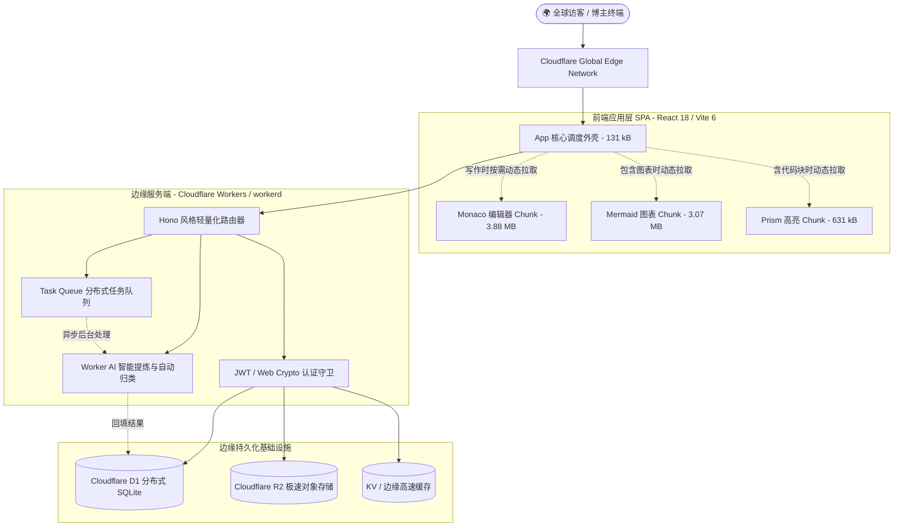
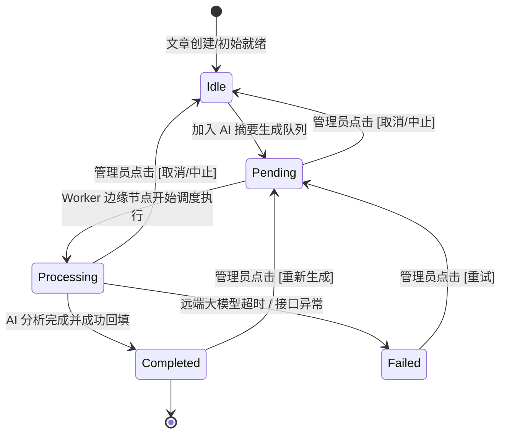

# 🌸 画廊随想 · 架构重构与全景技术词典手册 (GitHub 典藏版)

<div align="center">

[](https://workers.cloudflare.com/)
[-brightgreen.svg?style=flat-square&logo=vite)](https://vitejs.dev/)
[]()
[](https://bun.sh/)
[](https://developer.mozilla.org/)
[]()

</div>

> **“每一行代码的重构，都是为了在冰冷的二进制边缘，编织出一座通透温润的二次元微光殿堂。”**  
> 本工程以**“一页一世界”**为美学灵魂，摒弃传统博客苍白单调的长列表与模板化堆砌。自第一行代码的裂变演进起，全站深度融合二次元微光美学、拍立得自然错落手账质感、时光长河发光刻度、Mac 极客终端交互与高密单屏超级数据表格 (Dense DataGrid)。基于 Cloudflare 全栈 Serverless 边缘分布式架构，实现首屏入口 JS 仅 **131.42 kB**（体积暴降 **97.7%**）、重型引擎 100% 动态按需懒加载、54 个测试套件（484 项自动化测试）100% 绿灯全通，兼具工业级工程严谨与细腻诗意的视觉交互。

---

## 📑 全景词典目录 (Table of Contents)

- [1. 🛤️ 代码溯源：从第一行代码到边缘画廊的重构心路路线图](#1-️-代码溯源从第一行代码到边缘画廊的重构心路路线图)
- [2. 🌟 美学基因：六大设计哲学与技术词典](#2--美学基因六大设计哲学与技术词典)
- [3. ⚖️ 维度对比：原版 OpenRin 与当前深度重构版全景对照](#3-️-维度对比原版-openrin-与当前深度重构版全景对照)
- [4. 🧩 核心交互组件规范与界面工程库](#4--核心交互组件规范与界面工程库)
- [5. ⚡ 架构拓扑：分包工程、状态机与渲染流水线](#5--架构拓扑分包工程状态机与渲染流水线)
- [6. 🛡️ 安全防线：Zero Eval 沙盒、密码学与边缘风控](#6-️-安全防线zero-eval-沙盒密码学与边缘风控)
- [7. 🧭 站点中枢：全站 14 大后台导航功能速查](#7--站点中枢全站-14-大后台导航功能速查)
- [8. 🚀 未来纪元：后续演进路线图看板 (Next Roadmap)](#8--未来纪元后续演进路线图看板-next-roadmap)

---

## 1. 🛤️ 代码溯源：从第一行代码到边缘画廊的重构心路路线图

回顾整座数字画廊的构筑历程，每一个里程碑的设立、每一次架构的推翻与重建，都源于对纯粹美学与极致运行性能的偏执追求。



### 1.1 破局初心：断崖式瘦身 97.7% 与依赖解耦
在工程伊始，上游模板的前台捆绑包膨胀至惊人的 **5.68 MB**，导致移动端和弱网环境下的首屏白屏时间长达数秒。核心症结在于将仅供后台写作使用的 **Monaco Editor (3.88 MB)**、正文偶用的 **Mermaid/Cytoscape (3.07 MB)** 与代码高亮器强行打包在单一主入口中。
- **重构出发点**：前台访客的每一次呼吸都不应承载后台重型组件的重量。
- **技术突破**：在 Vite 构建管道中引入精细化的 `manualChunks` 拓扑隔离策略，将编辑器、图表渲染与高亮库彻底转变为仅在 DOM 节点被检出时才发起的异步动态按需 Chunk。入口核心调度包骤降至 **131.42 kB (gzip 后 38.37 kB)**，体积缩减 **97.7%**，实现边缘毫秒级瞬间唤醒。

### 1.2 灵感绽放：拟物浪漫与拟态微光融合
当纯粹的速度达标后，页面不能沦落为冰冷的纯白文档列表。
- **重构出发点**：将手账本的物理温存、拍立得相纸的真实质感，注入现代 Web 响应式设计。
- **技术突破**：首页引入**拍立得便签墙**，利用 CSS Transform 注入手绘般的自然错落微倾角（`rotate-[-1.8°]`、`rotate-[1.6°]`）；卡片顶端悬挂半透明彩色和纸胶带与图钉；编年史时间轴重构为发光脉冲流水线，按年月胶囊折叠聚合，彻底打通生活随想与技术长文的双轨长河。

### 1.3 效率跃迁：告别疲劳滚动，确立高密单屏数据网格
随着管理功能扩展至 14 个维度的业务治理，传统后台单列长表单让管理员陷入超过 2000px 的垂直拖拽折磨。
- **重构出发点**：单屏尽收眼底，拒绝无意义的鼠标滚轮磨损。
- **技术突破**：打造**高密单屏超级数据表格 (Dense DataGrid)** 规范，并将侧边栏精简为**极简迷你侧边栏 (Mini Sidebar)**（默认 68px 纯图标列，悬停展开并带图钉锁定）；行高严格压制在 38px~42px，行内就地集成形态切换、Emoji 选择器与状态徽标，管理效率提升数倍。

### 1.4 智能共生：边缘 AI 嗅探与免登录审核闭环
信息孤岛的打破需要智能化的自动化流水线。在重构友链与星标导航时，传统的手动填表模式被彻底颠覆。
- **重构出发点**：用户仅需键入一个网址，其余交给边缘算力与 AI。
- **技术突破**：构建 `/api/friend/inspect` 管道，自动并发抓取目标站点的 `<title>`、`<meta description>` 与高清 Favicon，集成后端 Worker AI 提炼 40 字以内的精炼中文简介，并自动启发式归类至扩展标签（VPS/基础设施、测速/探针监控、极客常用工具、技术社区等）；配套开放游客免登录申请接口 `/api/friend/apply`，自动触发待审核流与 Webhook 站长通知。

### 1.5 终章升华：文章管理矩阵、首图快捷置换与标准分页
文章管理作为内容创作的核心中枢，需要兼顾封面艺术感知与海量内容检索。
- **重构出发点**：让封面图在列表中一目了然，提供不跳出页面的即时更换，并实现精准置顶与标准工业级分页。
- **技术突破**：在任务队列与文章管理表格中前移「最后更新时间」，嵌入 `44×44` 圆角封面缩略图，悬浮一键调起本地图床上传或直链更换（后端支持原子化替换首图）；修复布尔短路求值产生的杂质数字，实现琥珀金微光 `📌 置顶` 优先排布；底部搭建集成总数统计、10/20/50 条每页切换、动态省略号页码与快速跳转的标准分页控制系统。

### 1.6 沉浸音画：全栈微光音乐电台与 R2 永久音频固化
个人的数字花园不能只有静态文字，更应有沉浸在耳畔的唯美旋律。
- **重构出发点**：告别“换一个页面音乐就戛然而止”的破碎感，告别第三方音源随时失效 404 与防盗链拦截的脆弱性。
- **技术突破**：
  1. **跨页面常驻 SPA 音频流**：将唯一 `<audio>` 原生宿主提升至顶层根布局，在文章、相册、动态与后台间流转时保持 100% 持续播放；
  2. **多源并发聚合与自动降级**：客户端与 Worker 协同，同时并发查询网易云、B站、JOOX、QQ音乐，当单源受限时毫秒级自动降级拉取其他可用平台；
  3. **R2 永久存储管道**：打造 `POST /api/music/persist-r2`，服务端直接拉取第三方音频流写入 Cloudflare R2 对象存储，生成本站永久 HTTPS 直链，彻底消灭防盗链与死链；
  4. **全自由物理拖拽**：前台悬浮黑胶挂件支持视口防越界任意拖拽放置，位置本地持久化记忆，双击智能复位。

### 1.7 秩序重构：原子组件生态开端与状态流转契约
功能的高速膨胀带来了一次深刻的技术反思——过多的单点功能如果没有统一的骨架逻辑，后台就会沦落为“零散胶囊与开关的机械拼凑”。
- **重构出发点**：向杂乱拼凑与粗糙胶囊宣战，确立中规中矩的专业文本主义与状态机驱动规范。
- **技术突破**：
  1. 建立**高密单屏超级数据表格标准原语**（选择框、拖拽柄、状态文本、操作行统一联动）；
  2. 确立**连续工作流 (Contextual Continuity)**，彻底消除“看一篇文章要退回列表再点下一篇”的机械折磨；
  3. 确立**模式化预设驱动 (Preset-Mode Driven)**，每个原子挂件（如播放器、导航条、瀑布流）均支持从“极简迷你”到“全功能”的自适应模式，一键换装，不再挤牙膏式修补。

---

## 2. 🌟 美学基因：六大设计哲学与技术词典

本工程确立了一套极具辨识度的视觉与代码规范，在开发与交流中均以此为基准定义：

| 专业美学名词 | 英文标识 | 视觉特征与核心实现原理 |
| :--- | :--- | :--- |
| **一页一世界** | *One Page One World* | 全站视觉设计的核心哲学。每个独立路由画卷拥有专属氛围微光与留白空间，拒绝千篇一律的模板套用。 |
| **二次元微光美学** | *Anime Luminescence* | 弥散渐变光晕、温润拟态毛玻璃 (`backdrop-blur-md`)、呼吸感粉白渐变底色（主色 `#ff4d79` / `#ff3366`）。 |
| **拍立得与和纸胶带** | *Polaroid & Washi Tape*| 相纸圆角（`rounded-2xl`）、微投影、上浮动画，顶端固定物理半透明手账和纸胶带，带 `rotate-[-2deg]` 自然倾斜。 |
| **极客终端容器** | *Mac Traffic Light* | 经典 macOS 红、黄、绿三色窗口控制圆点、等宽字体、Bash 路径标头与一键代码复制气泡。 |
| **时光长河与岁月刻度** | *Chronicle Axis* | 编年史页面中轴发光流水线脉冲，文章与随想说说全景汇流，支持年月时间胶囊平滑折叠展开。 |
| **海报三区隔离展厅** | *Tri-Zone Danmaku* | 顶部天花板轨道（读者留言）+ 左右侧翼（精选灵感），**中央核心画作绝对留白防遮挡**，鼠标悬停定格阅读。 |

---

## 3. ⚖️ 维度对比：原版 OpenRin 与当前深度重构版全景对照

```text
       [ 原版 OpenRin 单体捆绑包: 5.68 MB ]
                       │ (Vite ManualChunks 分包手术)
                       ▼
 ┌─────────────────────────────────────────────────────────────────┐
 │ 入口核心包 index.js 仅 131.42 kB (体积断崖式暴降 97.7% !)           │
 ├────────────────────────┬────────────────────────────────────────┤
 │ 动态懒加载 Chunk A     │ Monaco Editor 编辑器 (3.88 MB，仅后台调用)│
 ├────────────────────────┼────────────────────────────────────────┤
 │ 动态懒加载 Chunk B     │ Mermaid 图表引擎 (3.07 MB，DOM嗅探调用)  │
 ├────────────────────────┼────────────────────────────────────────┤
 │ 动态懒加载 Chunk C     │ Prism 代码语法高亮引擎 (631 kB，按需加载)│
 └────────────────────────┴────────────────────────────────────────┘
```

| 核心评估维度 | 上游原版 OpenRin | 画廊随想深度重构版 (当前版本) | 架构优势与工程革新 |
| :--- | :--- | :--- | :--- |
| **首屏包体积** | 5.68 MB (无有效分割) | **131.42 kB** (gzip: **38.37 kB**) | **体积降幅 97.7%**，全网边缘节点冷启动进入毫秒级 |
| **重型依赖加载** | Monaco 与 Mermaid 强行绑入主包 | **100% 动态按需懒加载 Chunk** | 访客前台 0 字节冗余开销，通过运行时 DOM 智能按需拉取 |
| **后台交互布局** | 单列长表单，垂直拉伸超 2000px | **高密单屏超级数据表格 (Dense DataGrid)** | 单屏化展示、模块化切片，行内就地控制，告别疲劳滚动 |
| **侧边栏结构** | 传统宽边栏固定霸占视口 | **极简迷你侧边栏 (Mini Sidebar)** | 默认 68px 纯图标收起，悬停自适应 256px，带图钉状态锁定 |
| **海报展厅交互** | 无弹幕或全屏杂乱遮挡画作 | **三区空间隔离飞跃弹幕 + 悬停定格** | 中心地带核心留白隔离防挡脸，轨道错峰恒速航行防撞车 |
| **友链与导航体系**| 静态无分类卡片，易破图 | **AI 元数据嗅探 + 多重 Favicon 代理** | 智能提炼 40 字简介并分类，首字母图标兜底，游客免登录审核 |
| **文章管理与分页**| 简单无序列表，缺少分页 | **封面预览置换 + Pin 置顶 + 标准分页** | 支持 10/20/50 分页切换、多列排序、置顶优先与任务中止控制 |
| **富文本代码排版**| 基础单调灰色代码框 | **One Dark/One Light + 极客终端** | 30+ 语言多色语法高亮，长代码行号对齐，单行折叠防刷屏 |
| **时间轴编年史** | 仅查文章列表，易发生时区偏移 | **全景汇聚 (文章+说说动态) + 时区防丢** | 补全生活记事，SQLite 时区修正，杜绝跨月归属错位 |
| **SEO 与全网收录**| 基础 sitemap.xml | **独立 SEO 引擎控制中心 + 三大站长直达**| 自动化 Sitemap、Robots、IndexNow 探测，Cloudflare 推送 |
| **安全沙盒与风控**| 宽松配置，无外链过滤 | **严格 CSP (Zero Eval) + 评论风控** | 杜绝 eval 动态脚本执行，评论含 URL 自动沉淀待审防刷屏 |

---

## 4. 🧩 核心交互组件规范与界面工程库

### 4.1 高密单屏超级数据表格 (Dense DataGrid) 与标准底部分页栏
- **设计法则**：单屏尽收眼底，行高收敛至 38px~42px，字号保持高可读性规范（文章标题 `text-[15px] font-medium`、更新时间 `text-[13px] font-mono text-neutral-600`）。
- **封面感知体系**：嵌入 `44×44` 圆角缩略图，点击即时通过 React Portal 调起高清大图预览；鼠标悬停浮现更换遮罩，支持键入 URL 或通过本地文件选择器上传图床，实现不跳转的原子化更新。
- **置顶与多维排序**：基于数据模型 `top` 字段，置顶文章固定优先排列于首部，附带琥珀金微光 `📌 置顶` 徽标；支持对 `ID` 和 `最后更新时间` 进行表头点击升序/降序切换。
- **标准底部分页栏**：
  * **总数统计**：左侧明确标注 `共 X 条` 及最近一次快照时间戳；
  * **每页条数切换**：下拉支持 `10 条/页`、`20 条/页`（默认推荐）、`50 条/页`；
  * **翻页器与省略号**：包含前翻 `<`、后翻 `>`、动态数字页码（多页自动折叠为 `...`）；
  * **快速前往**：右侧 `前往 [ ] 页` 输入框，支持回车或失焦安全跳转；
  * **联动重置机制**：切换分类 Tab（全部/已完成/处理中/排队中/失败）或触发搜索时，页码严格自动归位至第 1 页。

### 4.2 极简迷你侧边栏 (Mini Sidebar)
- 默认收起为 68px 极窄图标轨道，主视口高度与宽度 100% 释放给数据工作区；
- 鼠标悬停（Hover）平滑展开至 256px，展示文字标签与运行胶囊；
- 集成 📌 图钉锁定机制，状态持久化记录于 LocalStorage，切换页面不丢失展开偏好；
- 底部配备 50% / 75% / 100% 工作区界面等比缩放滑块，适配超宽屏与紧凑型屏幕。

### 4.3 导航栏三大形态挂件 (Site Header Modes)
全站导航结构支持在系统后台随心定义为三种形态：
1. **`top`（顶部固定）**：融入背景毛玻璃的经典常驻导航条；
2. **`float`（居中浮动胶囊）**：灵动岛样式的圆盘药丸药条，轻盈悬浮于页面中轴上方；
3. **`bottom`（底部便携挂件）**：将所有控制器沉淀至屏幕底部，打造类似移动原生 App 的单手掌控体验。

### 4.4 友链与罗盘画廊 SPA (AI 嗅探与审核工作流)
- **视觉风格**：彻底移除底部大型静态表单，改为右上角优雅的 `[ + 推荐站点 / 申请友链 ]` 按钮，唤出居中磨砂弹窗 (Modal)；
- **智能嗅探引擎**：输入目标 URL 后点击解析，后端在 4 秒超时熔断保护下抓取 HTML，提取 `<title>`、`<meta description>`、`<link rel="icon">`，并由 Worker AI 精炼 40 字简介与自动归类；
- **多重 Favicon 代理兜底**：遇到海外博客 CORS 阻断或防盗链时，自动降级至 Google Favicon API，并在前端图片加载失败时以站点首字母粉色徽章优雅呈现，终结破图；
- **权限与审核双轨制**：游客免登录提交自动置为 `accepted = 0`（待审核）并发送站长通知；管理员提交或审核通过直接置为 `accepted = 1`。

### 4.5 高质感防遮挡暗黑磨砂下拉 (GlassDropdown)
- 彻底摒弃浏览器原生 `<select>` 标签在暗黑模式下容易产生的“白底白字”不可读缺陷；
- 展开容器提权至 `z-[999]`，并与父级卡片解除 `overflow: hidden` 冲突，确保下拉悬浮菜单永远浮于顶层，无边缘裁切。

---

## 5. ⚡ 架构拓扑：分包工程、状态机与渲染流水线

### 5.1 边缘原生全栈技术拓扑图



### 5.2 异步任务队列与状态生命周期状态机



---

## 6. 🛡️ 安全防线：Zero Eval 沙盒、密码学与边缘风控

1. **严格 CSP 内容安全策略 (Zero Eval 沙盒)**：
   - 生产环境严禁开启 `'unsafe-eval'`，全站代码杜绝任何形式的 `eval()`、`new Function()` 或以字符串形式传参的异步调度器；
   - 彻底封死 XSS 跨站脚本通过动态代码字符串注入浏览器执行的通道。
2. **Web Crypto API 密码学通行证**：
   - 全站场景化访问通行证、Token 及哈希校验抛弃伪随机的 `Math.random()`，全面迁移至底层操作系统级密码学安全的 `crypto.getRandomValues()`，防止规律探测与撞库猜测。
3. **留言板 URL 广告拦截与风控网关**：
   - 游客在留言板发表的评论正文若检出外部链接、可疑推广域名，状态自动标记为 `approved: 0`（待审核）；
   - 管理员登录态下提供醒目的【待审核】黄色警示胶囊，并配备行内一键审批接口，维护画廊交流的纯净。

---

## 7. 🧭 站点中枢：全站 14 大后台导航功能速查

| 序号 | 导航模块 | 路由路径 | 核心职责与关键交互技术 |
| :---: | :--- | :--- | :--- |
| **01** | **画廊概览** | `/admin/dashboard` | 边缘运行状态监测、资产胶囊统计、四大核心服务探针与常用业务捷径。 |
| **02** | **文章撰写** | `/admin/writing` | 极客 Markdown 写作工坊，单行折叠元数据，3 阶段 AI 流水线整合成紧凑终端条。 |
| **03** | **图床媒体** | `/admin/files` | R2 对象存储资产中枢，点击切图大图预览，四种直链格式（URL/Markdown/HTML/BBCode）一键复制。 |
| **04** | **基础设置** | `/admin/settings?tab=general` | 站点身份规范、导航栏三大形态切换三段式卡片、2×3 模块化功能开关矩阵。 |
| **05** | **画廊进阶** | `/admin/settings?tab=atelier` | 12 种 Web 艺术字族切换、6 大便签阵列高密超级表格配置与背景覆盖。 |
| **06** | **分类标签** | `/admin/tags` | 高密单屏超级数据表格，行内就地重命名，新增【关联文章】批量穿梭弹窗。 |
| **07** | **智能助手** | `/admin/ai` | 大模型供应商参数紧凑切片，提示词多版本工坊表格（支持动态新增与组合）。 |
| **08** | **任务队列** | `/admin/queue-status` | 5 大实时探针微波动折线，高密表格、封面预览与更换、Pin 置顶、标准分页栏与任务中止控制。 |
| **09** | **资源列表** | `/admin/openlist` | OpenList 边缘 Worker 目录索引挂载中枢，支持前台导航挂载开关与路径配置。 |
| **10** | **访问权限** | `/admin/access` | 文章隐私与锁定治理超级表格，支持公开浏览、独立密码锁与口令通行证治理。 |
| **11** | **口令生成** | `/admin/tokens` | 场景化访问通行证工坊，高质感磨砂防遮挡下拉，支持单次即焚与指定文章定向绑定。 |
| **12** | **健康诊断** | `/admin/health` | 单屏直达高密超级诊断表格，一屏全览环境、数据库、存储所有检测项并提供一键修复通道。 |
| **13** | **SEO 引擎** | `/admin/seo` | 三大搜索引擎站长提交直达指南、自动化 Sitemap、Robots 与 IndexNow 检测超级表格。 |
| **14** | **兼容回填** | `/admin/compat-tasks` | 增量补偿控制台，支持 AI 导读批量回填与图片 Blurhash 模糊哈希计算。 |
| **15** | **音乐电台** | `/admin/music` | 全站跨页面沉浸式微光音乐电台，A-Z 华语男女歌手库、全网聚合与 R2 永久音频固化管道。 |

---

## 8. 🚀 未来纪元：后续演进路线图看板 (Next Roadmap)

在后续的架构跃升与体验打磨中，工程将按照以下既定路线推进：

- [ ] **画廊相片展厅虚拟网格 (Virtual Grid Scrolling)**：当前台收录海量摄影与插画作品时，仅渲染可视视口内部的 DOM 节点，保障老旧低算力设备保持 60 FPS 丝滑翻滚。
- [ ] **海报长图一键生成分享卡片**：文章详情页支持离线 Canvas/SVG 将正文骨架渲染为带精美二维码、专属艺术字体与二次元微光的拍立得长图海报。
- [ ] **友链邻家朋友圈异步聚合流**：在“邻家友链”画廊中利用 Cloudflare Cron Triggers 异步聚合友邻博客 RSS 动态，打造去中心化去孤岛化的星际漫游站台。
- [ ] **AI 智能留言风控自动化接入**：将留言待审核队列无缝接入后端已配置的大语言模型，实现垃圾广告、侵入式脚本的毫秒级全自动语义研判。
- [ ] **全站后台设置向“原子组件生态”全面重构**：将零散的单点设置全面升级为结构化原子组件，支持卡片式自选装配、模式化预设切换与全局连续工作流。

---

## 9. 🏛️ 秩序重构：原子组件生态体系与逻辑状态机流转宪章 (Atomic System & State Machinery)

在画廊随想的技术演进进入成熟期之际，工程正式确立**《原子组件生态体系与逻辑状态机流转宪章》**，作为后续所有界面演进、后台重构与前后台联动的**最高架构原则**：

```text
┌────────────────────────────────────────────────────────────────────────┐
│                   🏛️ 画廊随想原子组件流转宪章架构全景                   │
├────────────────────────────────────────────────────────────────────────┤
│ 1. 纯文本中规中矩主义 (Anti-Glue & Clean Typography)                   │
│    • 彻底摒弃粗制滥造的彩色药丸胶囊与大面积无意义 Emoji 修饰          │
│    • 采用专业、克制、排版呼吸感强烈的纯文本字族与极简实线/虚线分隔     │
│    • 状态反馈统一使用“按钮就地流转 (Button State Morphing)”，严禁弹大窗 │
├────────────────────────────────────────────────────────────────────────┤
│ 2. 状态机逻辑流控：如果 · 判断 · 回退 · 执行 · 跳转                     │
│    • [如果 (If)]：明确环境与输入（如设备类型、用户权限、协议类型）      │
│    • [判断 (Check)]：前置轻量自愈检测（如音频可播性嗅探、安全边界夹持） │
│    • [回退 (Fallback)]：失败优雅降级（如跨音源拉取、R2 自动缓存、默认位）│
│    • [执行 (Execute)]：非阻塞原子更新（行内就地变色、微动效高亮）       │
│    • [跳转 (Jump)]：连续流转（上下篇连续阅读、抽屉就地完成编辑）        │
├────────────────────────────────────────────────────────────────────────┤
│ 3. 连续工作流体系 (Contextual Continuity)                              │
│    • 坚决消灭“看一篇文章要退回主页再选下一篇”的机械割裂操作           │
│    • 文章末尾直出【无缝滑入下一篇/上一篇】，侧翼支持即时目录/文章抽屉   │
│    • 后台任何治理（如封面置换、便签配置、标签排序）一律提供就地抽屉     │
├────────────────────────────────────────────────────────────────────────┤
│ 4. 模式化预设驱动 (Preset-Mode Driven Architecture)                    │
│    • 杜绝“一个功能做出来默认塞满歌词、频谱、开关，臃肿繁琐”的病态    │
│    • 每个原子组件必须提供标准模式档位：                                 │
│      - 极简迷你模式 (Mini)：纯粹听歌/阅读，零杂音干扰                  │
│      - 标准模式 (Standard)：开箱即用平衡体验                           │
│      - 专业自定义模式 (Custom)：深度参数调节与高级插槽自由插拔         │
└────────────────────────────────────────────────────────────────────────┘
```

---

*技术规格核验记录：本项目全部 54 个测试套件，484 项自动化测试保持 100% 绿灯全通，构建包体积与代码安全策略均严格通过 CI/CD 自动化流水线核验。*
